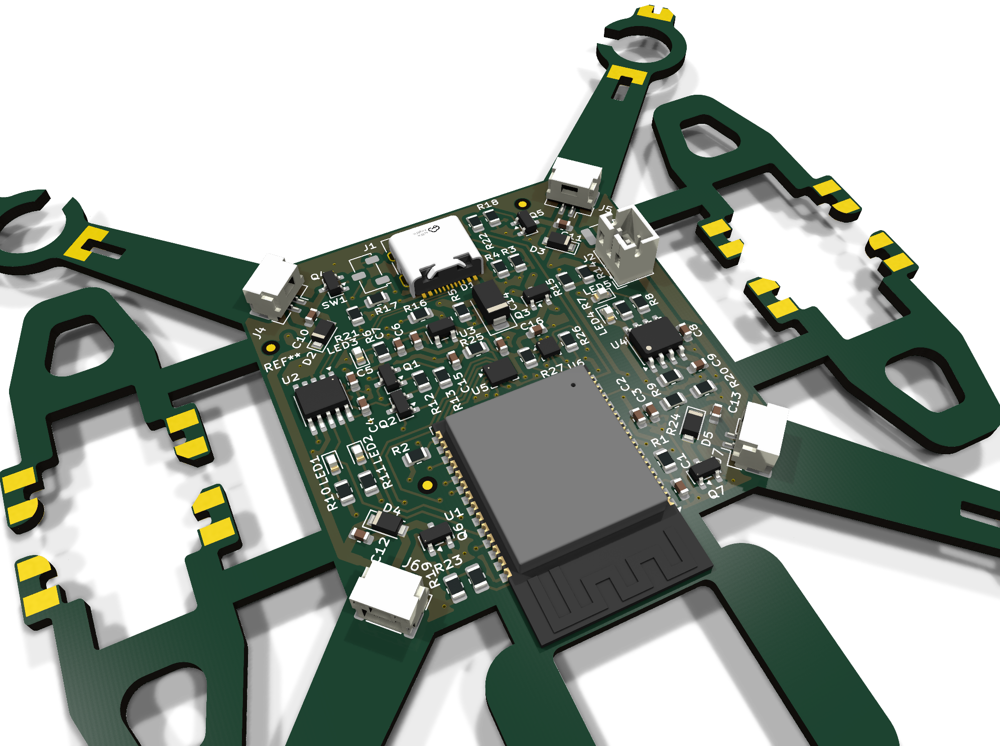
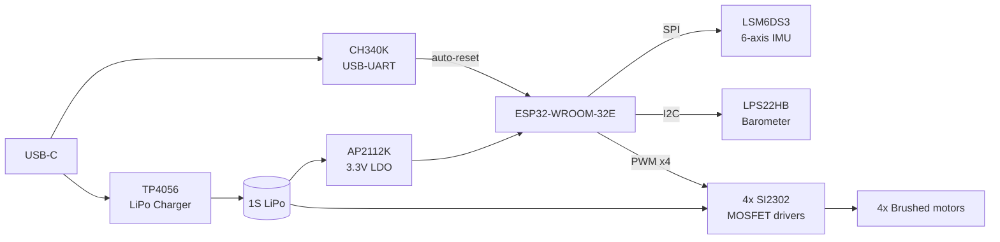
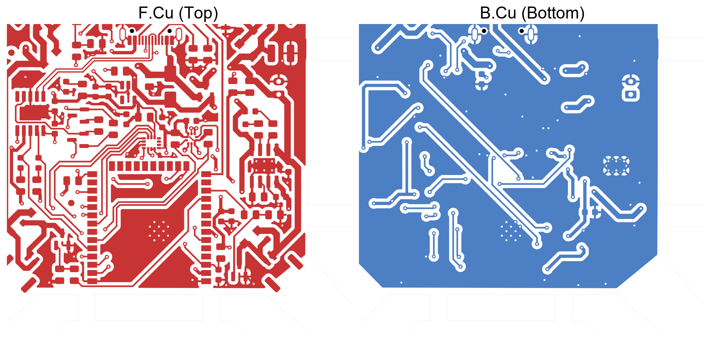
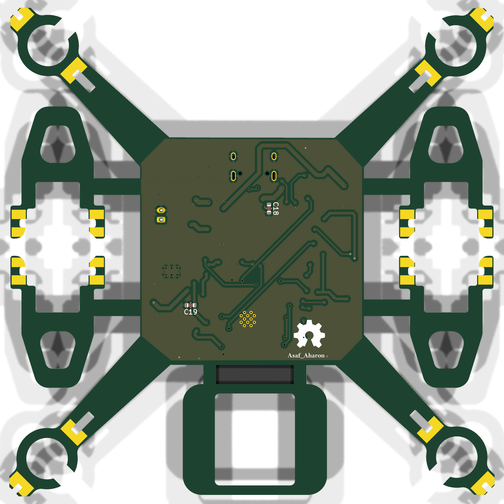
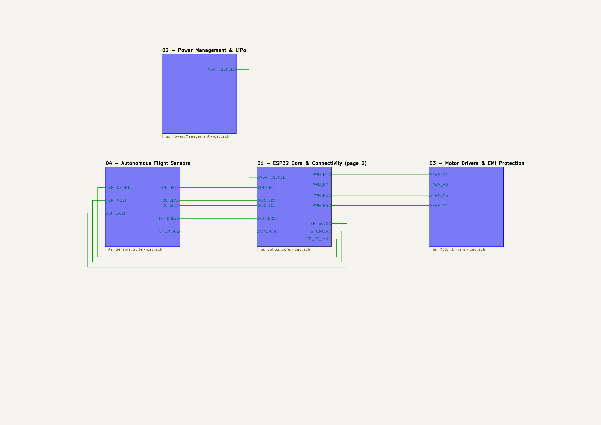
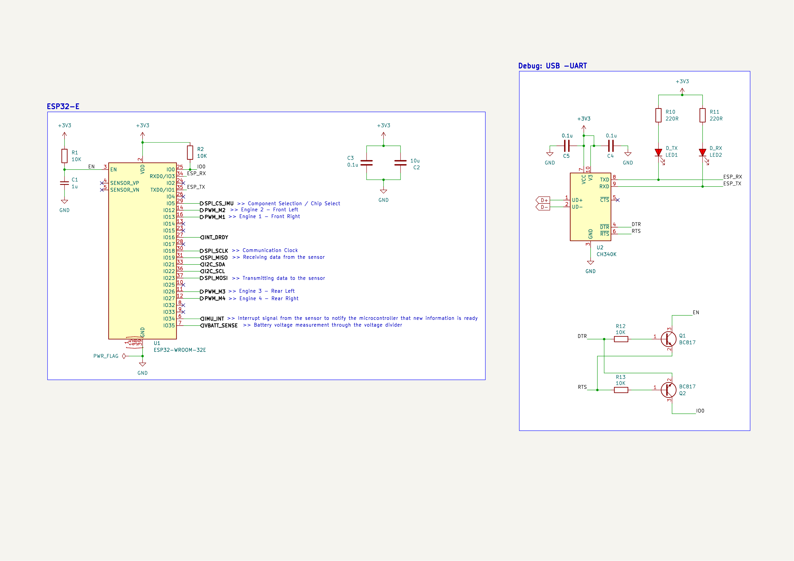
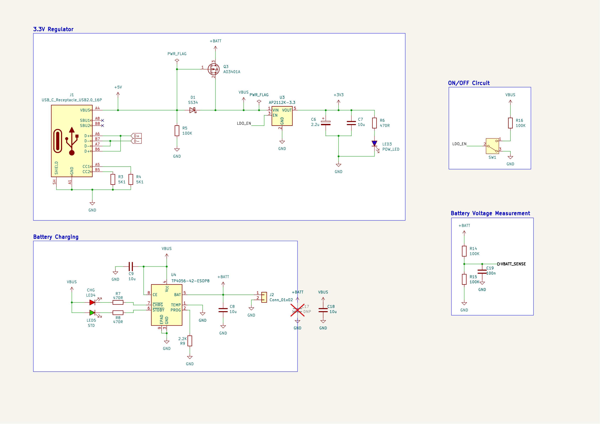
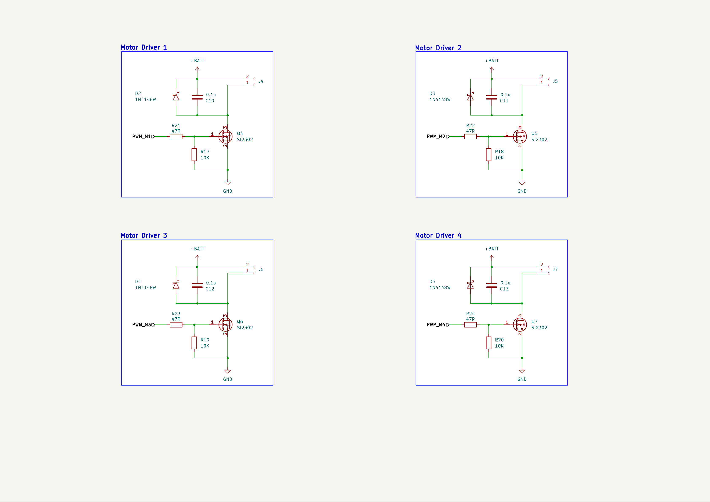
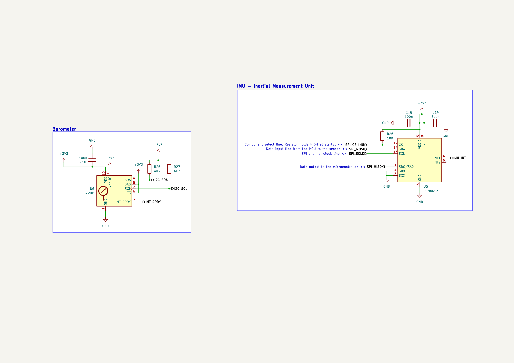

<div align="center">

# 🚁 ESP32 Drone Controller Board

**A Wi-Fi/Bluetooth micro-drone where the PCB *is* the airframe. Flight controller, motor drivers, sensors, and LiPo charging all sit on one 2-layer board.**




</div>

---

## ✨ Highlights

- **PCB airframe:** four arms with integrated motor mounts and slot-in landing legs, ~103 × 104 mm, so no separate frame is needed.
- **ESP32-WROOM-32E** with an on-board antenna keep-out, for Wi-Fi / BLE control.
- **Four brushed-motor channels:** logic-level MOSFETs with flyback diodes, gate resistors, and gate pull-downs on every channel.
- **Flight sensors:** a 6-axis IMU and a barometric pressure sensor for altitude hold.
- **USB-C:** programming through a CH340K USB-UART bridge with auto-reset, plus single-cell LiPo charging.
- **Manufacturing ready:** Gerbers, drill files, BOM, and CPL.

## 🧩 Block Diagram



## 🔧 Key Components

| Function | Part | Notes |
|---|---|---|
| MCU | **ESP32-WROOM-32E** | Wi-Fi + BLE, dual-core |
| USB-UART | **CH340K** | BC817 auto-reset / boot circuit |
| Charger | **TP4056** | 1S LiPo charging with CHG / STDBY LEDs |
| Regulator | **AP2112K-3.3** | 600 mA low-dropout 3.3 V rail |
| Power path | **AO3401A**, SS34 | P-MOSFET USB/battery switching, Schottky protection |
| Motor drivers | **SI2302** ×4 + 1N4148W ×4 | Low-side switches with flyback diodes |
| IMU | **LSM6DS3** | 3-axis accelerometer + 3-axis gyroscope (SPI) |
| Barometer | **LPS22HB** | Absolute pressure sensor for altitude (I2C) |
| Connectors | USB-C 16P, JST-PH 2P (battery), 4× JST-GH 2P (motors) | |
| Power switch | Nidec CAS-120A | SPDT slide switch |

### Motor PWM pin map (for firmware)

| Motor | Position | GPIO |
|---|---|---|
| M1 | Front right | IO13 |
| M2 | Front left | **IO12** |
| M3 | Rear left | IO26 |
| M4 | Rear right | IO27 |

## 🖼️ Gallery

| PCB Layout (F.Cu / B.Cu) | 3D View (Bottom) |
|:---:|:---:|
|  |  |

<details>
<summary><b>📐 Schematics (click to expand)</b></summary>

| Sheet | Preview |
|---|---|
| Top level |  |
| 01 – ESP32 Core & Connectivity |  |
| 02 – Power Management & LiPo |  |
| 03 – Motor Drivers & EMI Protection |  |
| 04 – Autonomous Flight Sensors |  |

</details>

## 📊 Board Stats

| Layers | Size | Thickness | Parts | Pads | Vias | Unrouted | DRC |
|:---:|:---:|:---:|:---:|:---:|:---:|:---:|:---:|
| 2 | 102.9 × 103.7 mm | 1.6 mm | 76 | 299 | 90 | **0** ✅ | **0 errors** ✅ |

## 🔁 Revision 2

Rev 2 fixes the issues found while assembling the first board:

- **USB-C:** both D+ pins (A6/B6) and both D− pins (A7/B7) are now tied, so USB works in either cable orientation.
- **CH340K:**
  - UD+/UD− corrected.
  - TX/RX now crossed to the ESP32.
  - V3 tied to VCC (required at 3.3 V).
- **Motors:**
  - Drain traces widened to 0.8 mm.
  - M2 moved from IO14 (which outputs PWM at boot) to IO12, which the gate pull-down holds low at boot.
- **Power:**
  - 10 µF input capacitor at the LDO (C18, bottom side).
  - 100 nF filter on the battery-sense ADC (C19, bottom side).
  - Footprint for an optional 100 µF bulk capacitor on the battery (C17, not fitted).
- **Mechanical:** arm slots and leg notches widened from 1.33 mm to 1.80 mm, so the 1.6 mm landing legs fit.
- **DRC:** board-edge clearance check re-enabled. A custom rule exempts only the joint solder pads.

All top-side footprints are unchanged from Rev 1, so the original paste stencil can be reused. Full review: [`docs/Rev2_Design_Review.md`](docs/Rev2_Design_Review.md).

## 📁 Repository Structure

```
Drone_ESP32/
├── Drone_ESP32.kicad_pro / .kicad_sch / .kicad_pcb   # KiCad project (top level + PCB)
├── Drone_ESP32.kicad_dru        # Custom DRC rules
├── ESP32_Core.kicad_sch         # Sheet 01 – MCU, USB-UART, auto-reset
├── Power_Management.kicad_sch   # Sheet 02 – USB-C, LiPo charger, LDO, power switch
├── Motor_Drivers.kicad_sch      # Sheet 03 – 4x MOSFET motor drivers
├── Sensors_Suite.kicad_sch      # Sheet 04 – IMU + barometer
├── Drone_Custom.3dshapes/       # 3D model for the USB-C connector
├── Gerbers/                     # Gerbers, drill files, JLCPCB zip
├── BOM.csv · CPL.csv            # Bill of materials and placement (JLCPCB format)
├── docs/                        # Design review
├── DATA SHEET/                  # Component datasheets
└── images/                      # Renders & schematic exports
```

## 🏭 Manufacturing

**Bare PCB:**
1. Upload `Gerbers/Drone_ESP32_JLCPCB.zip` to JLCPCB.
2. Order with these options: 2 layers, FR-4, 1.6 mm, HASL.

**Assembly (optional):**
1. Enable **PCB Assembly** and upload `BOM.csv` and `CPL.csv`.
2. Review part placement and rotation in the preview before ordering.
3. C18 and C19 are on the bottom side, and C17 is not fitted.

---

<div align="center">

Designed by **Asaf Aharon** · [GitHub](https://github.com/Asaf66) · [LinkedIn](https://linkedin.com/in/asaf-aharon-015595231)

</div>
